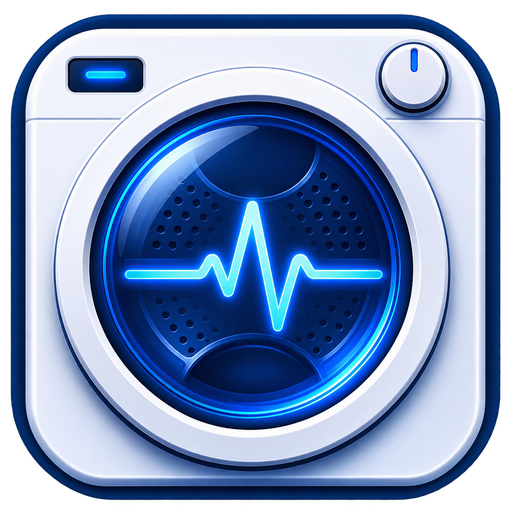

# ioBroker.laundrylens

[](https://www.npmjs.com/package/iobroker.laundrylens)
[](https://opensource.org/licenses/MIT)

Self-learning ioBroker adapter for automatic detection of washing machine and dryer cycles via smart plug power measurement. Recognizes running programs, estimates remaining time and sends Telegram notifications – fully local, no cloud.

> **Alpha release.** Tested on Siemens iQ washing machine and dryer. Other brands and models may require tuning. Feedback welcome.

---

## How it works

LaundryLens records the power consumption curve of each cycle and compares it against stored program profiles using segment-weighted correlation and a DTW-lite algorithm. Confidence is accumulated over multiple matching rounds before a program is accepted, which prevents single outliers from triggering a wrong match. Remaining time is estimated dynamically based on both elapsed time and the current energy rate – not just a fixed average.

The adapter is self-learning: there are no pre-built profiles. Every program is trained on your specific device. Recognition improves with each completed cycle.

---

## Features

- Cycle detection via state machine (OFF → STARTING → RUNNING ↔ PAUSED → ENDING)
- Self-learning program matching (segment-weighted correlation + DTW tiebreak)
- Score accumulation over multiple rounds with device-specific confidence thresholds
- Override lock: manually selected programs are not overwritten by background matching
- Adaptive remaining time estimation combining time-based and energy-rate signals
- Admin UI with expandable cycle list, inline power graph (canvas), phase legend, trim and split per touch/drag
  - This is why the adapter ships a custom admin tab (`admin/tab_m.html`) rather than relying on jsonConfig or the standard Device Manager component: neither supports rendering an interactive per-cycle power curve, editing phase boundaries by touch/drag, or splitting/trimming a recorded trace - all of which are core to how LaundryLens is used day to day (reviewing what a cycle actually did, correcting mismatches, building new program profiles from a trace).
- Telegram notifications with configurable update thresholds, placeholders (`{progress}`, `{prevTime}`, `{state:objectId}` for any ioBroker data point) and conditional text blocks
- Also supports Pushover, Signal, WhatsApp, Matrix, notify-my-android, Prowl, and email (via [ioBroker.email](https://github.com/iobroker-community-adapters/ioBroker.email)) as notification targets
- Multiple devices: one instance per device (washing machine, dryer, …)
- Localized, ready-to-display text data points (`phaseText`, `stateText`, `programText`) alongside the language-neutral internal ones, for dropping straight into a VIS dashboard

---

## Requirements

- ioBroker with js-controller ≥ 6.0.11
- Node.js ≥ 22
- A smart plug or power meter adapter providing a watt data point per device (e.g. [Shelly EM](https://www.shelly.com/en/products/shop/shelly-em))

---

## Installation

Install **LaundryLens** via the ioBroker Admin adapter list (tab "Adapters"), then create a separate adapter instance for each device and select the watt data point in the instance configuration.

---

## Configuration

Each instance has the following settings:

| Setting | Description |
|---|---|
| Device name | Display name for this device |
| Device type | `washing_machine` or `dryer` (affects phase detection logic) |
| Power sensor (W) | ioBroker data point providing watt values |
| Power threshold (W) | Minimum wattage to consider the device as running |
| Off delay (min) | Time to wait after power drops before ending the cycle |
| Start energy gate (Wh) | Minimum energy consumed before matching starts (filters short spikes) |
| Duration tolerance | Allowed deviation from learned average duration (0.05–0.5) |
| Matching interval (min) | How often matching runs during a cycle |
| Match confirmations | Number of consecutive rounds a match must hold before being accepted |
| Auto-confirm threshold (%) | Confidence at which a match is confirmed automatically |
| Instant-confirm threshold (%) | Confidence at which a match is accepted immediately (2 rounds in a row) |
| Program detection threshold (%) | Minimum confidence for a candidate to be considered at all |
| Notify on probable match | Send a notification even before a match is officially confirmed |
| Ignore anti-crease | Ignore anti-crease phases at the end of dryer cycles |

The defaults are tuned for Siemens iQ appliances. Detection threshold is a trade-off: lower means faster notifications but higher risk of wrong matches. Some experimentation is expected.

---

## Data points per device

| Data point | Type | Description |
|---|---|---|
| `state` | string | off / starting / running / paused / ending (language-neutral internal key, meant for automations) |
| `stateText` | string | Same as `state`, but as ready-to-display, localized text (e.g. "Running ⚙️" / "Läuft ⚙️") - see [`displayLanguage`](#configuration) |
| `running` | boolean | Simple on/off indicator |
| `program` | string | Detected program name |
| `programText` | string | Same as `program`, but with the `detecting...` placeholder localized (a confirmed program is your own saved name, passed through unchanged) |
| `confidence` | number | Match confidence in % |
| `timeRemaining` | number | Estimated remaining time in seconds |
| `totalDuration` | number | Estimated total cycle duration in seconds |
| `cycleProgress` | number | Cycle progress 0–100 % |
| `phase` | string | Current cycle phase (language-neutral internal key, e.g. `washing`, `dryer_drying`) |
| `phaseText` | string | Same as `phase`, but as ready-to-display, localized text with an emoji (e.g. "🫧 Washing" / "🫧 Wäscht") |
| `lastCycleProgram` | string | Program of the last completed cycle |
| `lastCycleDuration` | number | Duration of the last cycle in minutes |
| `lastCycleEnergy` | number | Energy consumed in the last cycle in Wh |
| `availablePrograms` | string (JSON) | Array of all saved program names, e.g. for external dropdowns |

`phase`/`state`/`program` are meant for automations/scripts and use fixed, language-neutral values that never change with your ioBroker language - use the matching `*Text` data point instead if you want to show status directly in a VIS dashboard without building your own translation table. The language for `phaseText`/`stateText`/`programText` defaults to the ioBroker system language, and can be overridden per device with the "Display language" setting.

---

## Using data points in notification messages

Besides the built-in placeholders (`{device}`, `{program}`, `{duration}`, `{energy}`, `{startTime}`, `{endTime}`, `{progress}`, `{prevTime}`), a notification message template can include the current value of **any** ioBroker data point with:

```
{state:objectId}
```

For example, to include the current outside temperature and electricity price in a "done" message:

```
🧺 {device} done!
⏱️ Total runtime: {duration} min
🌡️ Outside: {state:0_userdata.0.outsideTemp}°C
💶 Price: {state:0_userdata.0.electricityPrice} ct/kWh
```

This also works inside the conditional `[...]` blocks: `[🌡️ Outside: {state:0_userdata.0.outsideTemp}°C]` disappears from the message entirely if that data point is empty or doesn't exist, exactly like it would for an empty built-in placeholder. A missing or unreadable object ID never breaks the rest of the message - it just resolves to nothing.

---

## Getting started tips

- Let the device run at least 3–5 cycles per program before expecting reliable detection.
- Start with fewer programs. The fewer profiles you have, the higher the match accuracy.
- Use the **Cycles tab** in the admin UI to review past cycles, trim noise from the start/end of a recorded trace, or split a trace that captured two programs.
- Use the **Export** function before any update to back up your learned profiles and cycle history.

---

## Changelog

### **WORK IN PROGRESS**

### 0.5.0 (2026-11-12)
- New: light/dark theme in the admin tab (follows ioBroker Admin)
- Changed: SVG icons instead of emoji, transparent adapter icon
- Fix: programs table on small screens

### 0.4.44 (2026-11-08)
- Fix: splitting a cycle now splits its energy too (trim scales it, merging old split parts is corrected)
- Fix: admin error messages are now translated

### 0.4.43 (2026-11-08)
- Changed: merge a cycle with the previous one via a single button (Cycles tab)

### 0.4.42 (2026-11-08)
- New: merge 2-3 cycles into one in the admin tab (Cycles)

### 0.4.41 (2026-10-08)
- Fix: reported live - a cycle running noticeably longer than its historical average plateaued at ~99% progress / near-zero remaining time for a long stretch instead of correcting (a wash cycle showed 98% progress/2min remaining a full 34 minutes before it actually finished - confirmed from the debug log: still well inside an overrunning rinse phase, with spinning not even starting until 29 minutes later). Root cause: once the plain duration-average estimate (or, within a phase, that phase's typical duration) runs out, it has nothing more to contribute - but the live energy-based estimate (which tracks this specific run's actual pace, not a historical average) was still only partially trusted, as little as 30% weight for a consistent/low-CV profile
- Fixed by fully trusting the energy-based estimate once the whole-cycle average has run out (no phase data available), and leaning much more heavily on it (30/70 instead of 70/30) once the current phase has overrun its own typical duration - so an unusually long run corrects toward reality instead of sitting stuck near 0% remaining
- Covered by two new regression tests extending `tests/test_time_estimate.js` (one per branch)

### 0.4.40 (2026-10-07)
- Fix: reported live (notification history showing a predicted finish time creeping from 12:30 to 14:06 over the course of a single wash cycle, while `cycleProgress` stayed roughly accurate - over an hour off by the end) - the predicted finish time could drift later and later with every update. Root cause: whenever the recent power trace's variance exceeds a threshold (e.g. a washer motor cycling on/off during agitation), the remaining-time estimate gets "locked" to the last trusted value, to avoid jumpy/unstable predictions from noisy readings. The locked value was a frozen millisecond *duration* though, which never shrank while locked - so the countdown effectively stopped entirely for as long as the noisy condition persisted, while real wall-clock time kept passing, making `now + remaining` (the predicted finish time) creep later and later
- Fixed by decrementing the locked value by the real elapsed time since it was last touched, instead of freezing it as a constant - it now keeps counting down correctly even while locked, while still avoiding jumpy re-estimates from noisy readings (the original intent)
- Covered by a new regression test extending `tests/test_time_estimate.js`

### 0.4.39 (2026-10-06)
- Fix: reported live - `elapsedTime` stayed frozen (often at a stale value left over from a previous cycle) for the entire "detecting..." period of a new cycle, only starting to update once a program was actually confirmed (observed: stuck at 11342 while only ~15 minutes into a new washer cycle; for a dryer, jumped from frozen to 1096 the moment the program was recognized). Root cause: `elapsedTime` is just `Date.now()` minus the cycle's start time, with no real dependency on program detection - but the `onTimeUpdate` callback that wrote it (via `_onTime()`) returned early, skipping the write entirely, whenever `WashDataManager._updateTimeEstimate()` reported no program/bestCandidate yet
- Fixed by extracting the computation into a shared `_updateElapsedTime()` helper, now called unconditionally at the top of `onTimeUpdate` - before its "no program detected" early return - as well as from `_onTime()`'s normal path, so it updates from the moment a cycle starts running regardless of detection status
- Covered by a new regression test (`tests/test_elapsed_time_before_detection.js`)

Older changelog entries can be found in [CHANGELOG_OLD.md](CHANGELOG_OLD.md).

---

## Contributing

Issues and pull requests are welcome: [Issues](https://github.com/backfisch88/ioBroker.laundrylens/issues)

---

## License

MIT License

Copyright (c) 2026 backfisch88 <henrik.schoenhofen@icloud.com>

Permission is hereby granted, free of charge, to any person obtaining a copy
of this software and associated documentation files (the "Software"), to deal
in the Software without restriction, including without limitation the rights
to use, copy, modify, merge, publish, distribute, sublicense, and/or sell
copies of the Software, and to permit persons to whom the Software is
furnished to do so, subject to the following conditions:

The above copyright notice and this permission notice shall be included in all
copies or substantial portions of the Software.

THE SOFTWARE IS PROVIDED "AS IS", WITHOUT WARRANTY OF ANY KIND, EXPRESS OR
IMPLIED, INCLUDING BUT NOT LIMITED TO THE WARRANTIES OF MERCHANTABILITY,
FITNESS FOR A PARTICULAR PURPOSE AND NONINFRINGEMENT. IN NO EVENT SHALL THE
AUTHORS OR COPYRIGHT HOLDERS BE LIABLE FOR ANY CLAIM, DAMAGES OR OTHER
LIABILITY, WHETHER IN AN ACTION OF CONTRACT, TORT OR OTHERWISE, ARISING FROM,
OUT OF OR IN CONNECTION WITH THE SOFTWARE OR THE USE OR OTHER DEALINGS IN THE
SOFTWARE.
